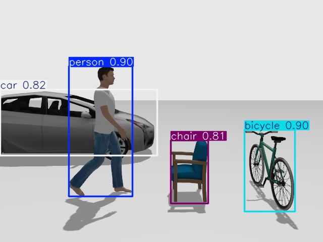
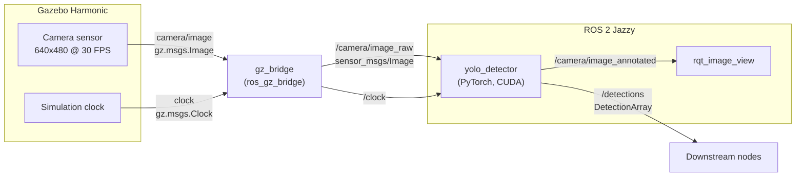

# ros2-vision-autonomy

Integrating computer vision and deep learning into autonomous systems with **ROS 2 Jazzy** and **Gazebo Harmonic** simulation.

A simulated camera streams images into ROS 2, where a YOLO detector running on the GPU publishes structured detections and an annotated debug image, all on the simulator's timeline.



*YOLO26n detecting a person, car, chair, and bicycle in the simulated `detection_world`.*

---

## Architecture



Key design points:

- **Sim time throughout.** Nodes run with `use_sim_time: true`, so timestamps and timers follow Gazebo's clock, including when the simulation is paused or runs slower than real time.
- **Detections stay tied to their frame.** Every `DetectionArray` and annotated image carries the header of the source image (its sim-time stamp and camera `frame_id`).
- **Empty arrays are meaningful.** The detector publishes every frame, even with zero detections, so silence means "detector stalled or crashed," not "nothing seen."
- **Sensor-data QoS.** Image subscriptions use best-effort delivery with a small queue, so stale frames are dropped rather than queued.

---

## Packages

| Package | Build type | Contents |
|---|---|---|
| `vision_interfaces` | `ament_cmake` | Custom messages: `BoundingBox`, `Detection`, `DetectionArray` |
| `vision_sim` | `ament_python` | Gazebo worlds, bridge configuration, simulation launch file |
| `vision_perception` | `ament_python` | `yolo_detector` (deep learning) and `color_detector` (classical HSV baseline) |
| `my_first_pkg` | `ament_python` | Learning exercises: publisher/subscriber, parameters, launch files, and a `fake_detector` for testing without simulation |

### Message definitions

```
# BoundingBox.msg  (normalized coordinates, 0 to 1)
float32 x_min
float32 y_min
float32 x_max
float32 y_max

# Detection.msg
string class_name
int32 class_id
float32 confidence
BoundingBox box

# DetectionArray.msg
std_msgs/Header header
Detection[] detections
```

The header lives on the array rather than on each detection, because every detection in a frame shares the same source image.

### Worlds

| World | Contents | Purpose |
|---|---|---|
| `camera_world.sdf` | Primitive shapes and a static camera | Bridge and color-detector testing |
| `detection_world.sdf` | Person, car, chair, and bicycle from Gazebo Fuel | YOLO detection (COCO classes) |

---

## Requirements

- Ubuntu 24.04
- ROS 2 Jazzy (`ros-jazzy-desktop`)
- Gazebo Harmonic via `ros-jazzy-ros-gz`
- An NVIDIA GPU with a working driver (developed on an RTX 2050, 4 GB)
- Python 3.12 (the system interpreter; **not** conda)

---

## Setup

### 1. System packages

```bash
sudo apt install ros-jazzy-desktop ros-dev-tools ros-jazzy-ros-gz \
                 ros-jazzy-cv-bridge python3-opencv python3-venv
```

### 2. Clone and create the Python environment

```bash
git clone https://github.com/Sulojan2027/ros2-vision-autonomy.git
cd ros2-vision-autonomy

/usr/bin/python3 -m venv --system-site-packages .venv
touch .venv/COLCON_IGNORE
source .venv/bin/activate
```

`--system-site-packages` lets the venv see ROS's apt-installed Python packages (`rclpy`, `cv_bridge`). `COLCON_IGNORE` stops colcon from treating the venv as a package.

### 3. Install PyTorch and the detector dependencies

Install PyTorch with CUDA using the command from [pytorch.org](https://pytorch.org/get-started/locally/), for example:

```bash
pip install torch torchvision --index-url https://download.pytorch.org/whl/cu126
pip install -r requirements.txt
```

`requirements.txt` pins `numpy<2` and `opencv-python<4.12`. ROS's `cv_bridge` is compiled against NumPy 1.x and fails to import if NumPy 2 shadows the system version.

Verify the environment:

```bash
source /opt/ros/jazzy/setup.bash
python check_env.py
```

Expected: NumPy 1.26 loaded from `/usr/lib/python3/dist-packages`, `cv_bridge` from `/opt/ros/jazzy`, `torch` and `ultralytics` from `.venv`, and `torch.cuda.is_available(): True`.

### 4. Download the model weights

Weights are not committed to the repository.

```bash
mkdir -p models && cd models
python -c "from ultralytics import YOLO; YOLO('yolo26n.pt')"
cd ..
```

### 5. Build with the venv's Python

```bash
source /opt/ros/jazzy/setup.bash
python -m colcon build --symlink-install
source install/setup.bash
```

Building through the venv's Python writes it into each node's shebang, so `ros2 run` and `ros2 launch` use the venv automatically without activating it. Check with:

```bash
head -1 install/vision_perception/lib/vision_perception/yolo_detector
# expected: #!/<path to repo>/.venv/bin/python
```

---

## Running

**Terminal 1: simulation and bridge**

```bash
ros2 launch vision_sim sim.launch.py world:=detection_world.sdf
```

The launch file sets the NVIDIA PRIME offload variables, so Gazebo renders on the discrete GPU on hybrid-graphics laptops. The first launch may pause while Fuel models download.

**Terminal 2: YOLO detector**

```bash
ros2 run vision_perception yolo_detector --ros-args \
  -p use_sim_time:=true \
  -p model_path:=$(pwd)/models/yolo26n.pt
```

**Terminal 3: view and inspect**

```bash
ros2 run rqt_image_view rqt_image_view     # select /camera/image_annotated
ros2 topic echo /detections
```

### Detector parameters

| Parameter | Default | Changeable at runtime | Description |
|---|---|---|---|
| `model_path` | `models/yolo26n.pt` | No | Absolute path to the weights |
| `confidence_threshold` | `0.5` | **Yes** | Minimum confidence, 0.01 to 1.0 |
| `device` | `'0'` | No | `'0'` for the first GPU, or `'cpu'` |
| `image_size` | `640` | No | Inference resolution, a multiple of 32 |

Tune the threshold live:

```bash
ros2 param set /yolo_detector confidence_threshold 0.3
```

### Classical baseline

```bash
ros2 launch vision_sim sim.launch.py
ros2 run vision_perception color_detector --ros-args -p use_sim_time:=true
```

Detects objects by HSV color thresholding and publishes the same `DetectionArray` type, so downstream nodes work with either detector.

---

## Performance

Measured on an RTX 2050 (4 GB), Intel i5-12450H, **on AC power with the performance power profile**. On battery, both CPU and GPU throttle and timings are significantly worse.

| Detector | Time per frame | Notes |
|---|---|---|
| `color_detector` (HSV) | about 3 ms | CPU only |
| `yolo_detector` (YOLO26n, GPU) | about 8.7 ms | Includes conversion and annotation; spikes to about 17 ms when sharing the GPU with Gazebo |
| YOLO warm-up (first inference) | about 1.7 to 2.4 s | Done at startup, before subscribing to the camera |

Frame budget at 30 FPS is 33 ms. GPU memory with everything running: about 830 MB of 4 GB (Gazebo GUI about 430 MB, Gazebo sensor rendering about 150 MB, detector about 190 MB).

---

## Troubleshooting notes

Lessons learned while building this, in case they save you time:

- **`ros2` or `gz` not found:** source `/opt/ros/jazzy/setup.bash`. In Jazzy, Gazebo is installed as ROS vendor packages, so `gz` also needs it.
- **`cv_bridge` crashes with a NumPy 1.x/2.x error:** NumPy 2 is shadowing the system NumPy. Reinstall with `pip install "numpy<2"` in the venv.
- **Node can't import `torch`:** check the executable's shebang. Rebuild with `python -m colcon build` from the activated venv.
- **CMake builds use the wrong Python** (for example, `No module named 'em'`): another Python on `PATH` (such as a uv-managed interpreter in `~/.local/bin`) is being picked up. Remove it or pin `-DPython3_EXECUTABLE=/usr/bin/python3`, then delete that package's `build/` folder.
- **Low real-time factor or slow inference:** plug in the laptop and set the performance power profile.
- **`nvidia-smi`: driver/library version mismatch:** the driver was updated in the background. Reboot.
- **Topic exists but no data arrives:** check names and QoS with `ros2 topic info -v`. Wrong topic names and incompatible QoS fail silently.
- **YOLO detects nothing in the shapes world:** expected. The model only knows the 80 COCO classes; use `detection_world.sdf`.

---

## Roadmap

- [x] ROS 2 fundamentals: nodes, topics, parameters, launch files
- [x] Custom message interfaces
- [x] Gazebo simulation with a camera bridged into ROS 2 on sim time
- [x] Classical detection with OpenCV and `cv_bridge`
- [x] Deep learning detection with YOLO on the GPU
- [ ] Mobile robot with an onboard camera
- [ ] Controller node driving the robot from detections
- [ ] Watchdog that stops the robot when detections stop

---

## License

The packages in this repository are licensed under the Apache License 2.0.

This project uses [Ultralytics YOLO](https://github.com/ultralytics/ultralytics), which is licensed under **AGPL-3.0**. If you build on this project, review the Ultralytics license terms, especially before any closed-source or commercial use.

Gazebo Fuel models used in `detection_world.sdf` are subject to their respective authors' licenses.